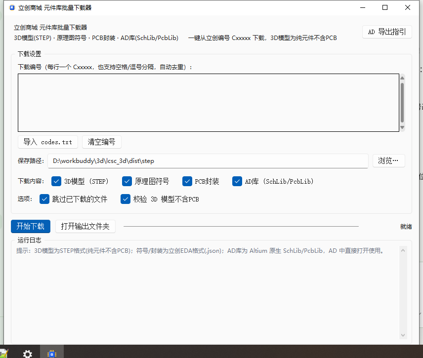

# 立创商城元件库批量下载器（LCSC Lib Downloader）

> **一个编号，四类文件** —— 3D 模型(STEP) · 原理图符号 · PCB 封装 · Altium 原生库(SchLib / PcbLib，可内嵌 3D)
>
> 免安装单文件 exe，带图形界面；纯 Python 标准库实现，支持批量下载、断点续传与风控重试。



---

## ✨ 功能特性

| 功能 | 说明 |
| --- | --- |
| 🔢 批量下载 | 界面粘贴多个编号、导入 `codes.txt`、命令行参数或列表文件均可；自动去重、跳过注释 |
| 📦 3D 模型 (STEP) | 下载的 3D 模型为**纯元器件**（不含 PCB 基板），并自动做几何校验 |
| 📐 原理图符号 | 立创EDA 标准格式 JSON，可在立创EDA(标准版/专业版)中导入 |
| 🧩 PCB 封装 | 立创EDA 标准格式 JSON，含焊盘/丝印/阻焊层完整数据 |
| 🅰 AD 原生库 | 直接生成 Altium Designer 原生 `.SchLib` / `.PcbLib`（二进制格式），**可选内嵌官方 3D 模型** —— AD 中打开按快捷键 `3` 即可查看立体效果 |
| 🛡 风控对抗 | 请求间隔控制 + 指数退避重试，被断连自动恢复；已下载文件自动跳过（断点续传） |
| 🖥 免环境运行 | 单文件 exe，目标电脑**无需安装 Python** 及任何运行库 |
| ⌨ 双形态 | 图形界面（GUI）+ 命令行（CLI），命令行版仅依赖标准库 |

## 🚀 快速开始

### 方式一：下载 exe（推荐）

到 [Releases](../../releases) 下载 `立创3D封装下载器.exe`，双击运行：

1. 在文本框粘贴立创编号（如 `C131443`，一行一个）；
2. 选择保存路径（默认 exe 同级 `step\` 目录）；
3. 勾选需要的内容（默认四项全选，AD 库默认内嵌 3D）；
4. 点击 **开始下载**。

> ⚠️ 首次运行如被杀毒软件拦截（打包程序的常见误报），添加信任即可。

### 方式二：源码运行（GUI）

```bash
pip install sv_ttk          # 仅界面主题需要，可选
python lcsc_3d_gui.py
```

### 方式三：命令行（CLI）

```bash
# 全量下载（3D + 符号 + 封装 + AD库）
python lcsc_3d_downloader.py C131443 C25804 C14663

# 从文件读编号
python lcsc_3d_downloader.py -f codes.txt -o D:\step

# 只生成 AD 库（默认内嵌 3D；加 --no-ad-3d 关闭）
python lcsc_3d_downloader.py C131443 --types ad

# 只下 3D 模型 / 只下符号+封装
python lcsc_3d_downloader.py C131443 --types 3d
python lcsc_3d_downloader.py C131443 --types symbol,footprint
```

## 📦 输出文件说明

以 `C131443`（GD32F303RCT6，LQFP-64）为例：

| 文件 | 大小(示例) | 说明 |
| --- | --- | --- |
| `C131443_LQFP-64(10x10).step` | 12.6 MB | 纯元件 3D 模型（实测 12.01×12.01×1.45 mm，65 个实体） |
| `C131443_GD32F303RCT6.symbol.json` | 14 KB | 原理图符号（66 个图元） |
| `C131443_LQFP-64_..._LS12.0-BL.footprint.json` | 98 KB | PCB 封装（206 个图元 / 64 个焊盘） |
| `C131443_GD32F303RCT6.SchLib` | 31 KB | **AD 符号库**（64 引脚，编号 1~64） |
| `C131443_LQFP-64_...-BL.PcbLib` | 2.2 MB | **AD 封装库**（64 焊盘 + 内嵌 3D 模型） |

## 🅰 AD 库（SchLib / PcbLib）使用指南

**生成的文件是 Altium Designer 原生二进制库**，两种用法：

1. **直接打开**：AD 中 `File → Open` 打开 `.SchLib` / `.PcbLib`；
2. **长期使用**：放入库面板 —— `Components 面板 → 菜单 → File-based Libraries Preferences → Add Library`。

**关于 3D 内嵌**：

- 勾选「AD库内嵌3D模型」（默认开启）时，会按官方放置参数把 3D STEP 内嵌进 PcbLib，AD 中按快捷键 `3` 查看 3D；
- 内嵌模型与官方源文件**逐字节一致**（zlib 压缩存储于 AD Models 流），已通过解压比对验证；
- 不需要内嵌时关闭该选项即可获得更小的 PcbLib（示例：106 KB vs 2.2 MB）。

## 🛠 从源码构建 exe

需要 Python 3.10+（含 tkinter）与 pip：

```bat
:: 直接运行一键打包脚本
build_exe.bat
```

或手动执行：

```bash
pip install pyinstaller sv_ttk
pyinstaller --onefile --noconsole --clean --name lcsc3d_gui \
  --icon app.ico --add-data "app.ico;." \
  --collect-all sv_ttk --paths . --collect-submodules lcsc3d \
  lcsc_3d_gui.py
```

打包产物在 `dist\` 下，可自由改名。内置 `--selftest` 自测模式（真实下载+校验，写 `selftest_result.txt`），便于发布前验证。

## 🔬 技术实现（简述）

- **数据来源**：3D 模型来自立创EDA 专业版接口链路；符号/封装来自立创标准版接口（明文 JSON）；两者均有风控，需完整浏览器请求头与退避重试。
- **「不含 PCB」校验**：解析 STEP 实体真实包围盒（只统计被 `EDGE_CURVE` 引用的顶点——倒圆角的圆心在模型外很远处，用全部坐标点会误判）。
- **AD 原生库**：基于对 AD 二进制格式（OLE 复合文档 + 长度前缀记录）的完整实现；3D 内嵌包括 OBJ 基准点解析、欧拉角/偏移换算、zlib 压缩 STEP、Models 流与 BODY 记录写入。
- **验证方法**：用独立解析器（olefile）反向读取生成的库，校验引脚数/焊盘数/内嵌模型解压比对；exe 在「最小 PATH + 清空 PYTHON 变量」环境下自测通过。

详细的技术拆解见：[docs/blog.md](docs/blog.md)。

## ❓ 常见问题

- **部分编号下载不了 3D 模型？** 该编号在立创库中没有关联 3D 模型（或为纯定制件），不影响符号/封装/AD 库下载。
- **提示风控/连接断开？** 程序内置自动重试；同时请避免多开窗口并保持默认请求间隔（1.2s）。
- **AD 库转换失败的编号？** 个别器件数据有特殊图元时会给出明确原因，不影响其余三类文件。
- **支持平台？** Windows 10/11 64 位（AD 库导出依赖 Windows 系统组件）。

## 📄 许可与致谢

本项目以 **AGPL-3.0** 许可开源（见 [LICENSE](LICENSE)）。

- 本项目内置了开源项目 [LCSC3D](https://github.com/Travelerrrrrr/LCSC3D) 的部分转换代码（`lcsc3d/` 目录，AGPL-3.0），用于立创数据 → Altium 库的转换，版权归其作者所有，来源与修改说明见 [`lcsc3d/NOTICE.txt`](lcsc3d/NOTICE.txt)；
- 通过本工具获取的元件数据（3D 模型、符号、封装等）版权归立创/嘉立创及相关厂商所有，请遵守其使用条款，仅用于个人合法的硬件设计工作。
